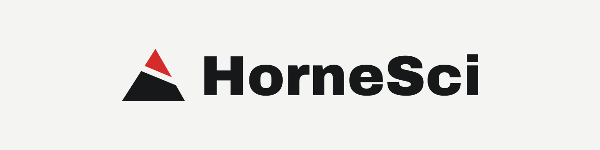

<picture>
  <source media="(prefers-color-scheme: dark)" srcset="https://raw.githubusercontent.com/HorneSci/.github/main/profile/assets/hornesci-profile-dark.svg">
  <source media="(prefers-color-scheme: light)" srcset="https://raw.githubusercontent.com/HorneSci/.github/main/profile/assets/hornesci-profile-light.svg">
  
</picture>

## Compute from what changed.

HorneSci builds software for systems that repeat the same computation on changing inputs. We work with simulation, solver, and monitoring teams to update results from the data that changed and measure the difference on their own workloads.

### Open source

[**HST Studio**](https://github.com/HorneSci/hst-studio) brings together Python tools for sparse-delta experiments, workload screening, and reproducible measurement.

- **spdelta** — compare delta updates with full recomputation and sparse baselines.
- **fitscreen** — screen a workload for the conditions incremental computation needs.
- **hstscan** — turn measured runs into workload records and offline recommendations.
- **claimlint** and **bindnum** — check numerical claims and connect them to measured results.

[Explore HST Studio →](https://github.com/HorneSci/hst-studio#readme)

### Work with us

We assess repeated computation in existing applications and implement changes with your engineers, on your hardware.

[HorneSci](https://hornesci.com) · [Delta Routing research](https://deltarouting.com) · [Contact](mailto:admin@hornesci.com)
